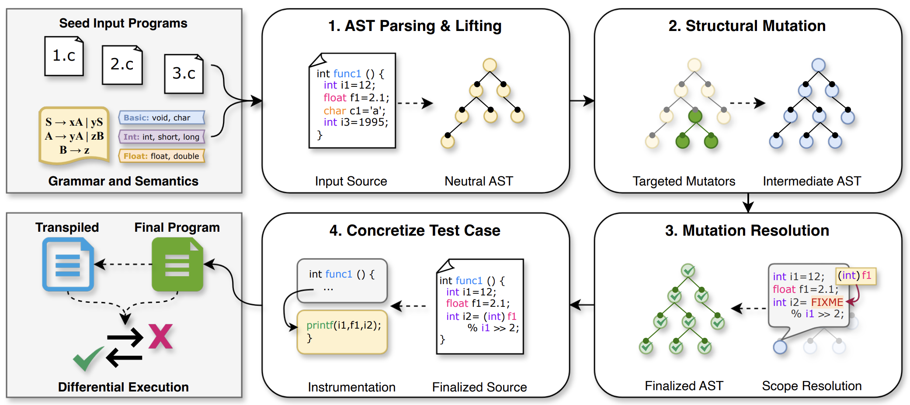

# TeTRIS: General-purpose Fuzzing for Translation Bugs in Source-to-Source Code Transpilers


This repository provides the source code for **TeTRIS**: our prototype fuzzer for source-to-source code transpilers.

This work is presented in our paper **[TeTRIS: General-purpose Fuzzing for Translation Bugs in Source-to-Source Code Transpilers](https://futures.cs.utah.edu/papers/25ACSAC.pdf)**, appearing in the 2025 Annual Computer Security Applications Conference (ACSAC'25).

* [Using TeTRIS](#using-TeTRIS)
* [Additional Notes](#additional-notes)
* [Bug Trophy Case](#bug-trophy-case)

<br>

<table>
  <tr>
    <td><b>Citing this repository:</b></td>
    <td>
      <code class="rich-diff-level-one">@inproceedings{arafat:TeTRIS, title = {TeTRIS: General-purpose Fuzzing for Translation Bugs in Source-to-Source Code Transpilers}, author = {Yeaseen Arafat and Stefan Nagy}, booktitle = {{Annual} {Computer} {Security} {Applications} {Conference} ({ACSAC})}, year = {2025},}</code>
    </td>
  </tr>
  <tr>
    <td><b>Maintainers:</b></td>
    <td>Yeaseen Arafat (<a href="mailto:y.arafat@utah.edu">y.arafat@utah.edu</a>) and Stefan Nagy (<a href="mailto:snagy@cs.utah.edu">snagy@cs.utah.edu</a>)</td>
  </tr>
  <tr>
    <td><b>License:</b></td>
    <td><a href="LICENSE">MIT License</a></td>
  </tr>
  <tr>
    <td><b>Disclaimer:</b></td>
    <td>This software is provided as-is with no warranty.</td>
  </tr>
</table>


# Using TeTRIS

## Install Prerequisite Packages
Install prerequisite packages by running `setup.sh`.

## Fuzzing a Transpiler
We provide example transpiler fuzzing setups in [transpilers](transpilers) (e.g. `c2rust`, `c4go`, etc.), including seeds and a corresponding `fuzz.py` launcher script.

Replicating a per-transpiler fuzzing setup generally requires the following:

1. Ensure the transpiler binary itself (e.g., `c2rust`) and any other necessary binaries (e.g., `clang`) are all accessible from your `$PATH` environment (details in each corresponding `README`).
2. Run a fuzzing campaign with the following: `python3 fuzz.py <trial_number>`.
3. Fuzzing outputs from that campaign will be saved in: `fuzzing/output_<trial_number>`.

As TeTRIS is built atop of the AFL fuzzer, we also recommend configuring your system as follows:
```
sudo sh -c 'echo core >/proc/sys/kernel/core_pattern'
sudo sysctl -w kernel.core_pattern="core" > /dev/null
sudo sysctl -w kernel.randomize_va_space=0 > /dev/null
sudo sh -c 'echo performance | tee /sys/devices/system/cpu/cpu*/cpufreq/scaling_governor'
```


# Additional Notes
Below are instructions for extending TeTRIS:

## Supporting Other Transpilers
- Follow any existing `fuzz.py` script.
- Provide seed directories in the script.
- Set the language in building TeTRIS.
- Provide necessary `fuzz_env_template`, instrumentation and verifier scripts.

## Supporting Other Languages
- Create a `<LANGUAGE>` folder under [generator/grammars](/generator/grammars/).
- Provide the BNF `grammar`, precedence declaration in `ff`, flex rules in `extra_flex_rules_<LAN>` and the semantic specification in `semantic_json`.


# Bug Trophy Case
| Transpiler | Reported Bugs |
| ---- | ---- |
| CxGo | https://github.com/gotranspile/cxgo/issues/75, https://github.com/gotranspile/cxgo/issues/76, https://github.com/gotranspile/cxgo/issues/77, https://github.com/gotranspile/cxgo/issues/78, https://github.com/gotranspile/cxgo/issues/79, https://github.com/gotranspile/cxgo/issues/80, https://github.com/gotranspile/cxgo/issues/81 |
| C4Go | https://github.com/Konstantin8105/c4go/issues/515, https://github.com/Konstantin8105/c4go/issues/516 |
| Go2Hx | https://github.com/go2hx/go2hx/issues/178, https://github.com/go2hx/go2hx/issues/179 |
| Zig Translate-C | https://github.com/ziglang/zig/issues/21855 |

If you find new bugs using TeTRIS, please let us know!


# Acknowledgement
This material is based upon work supported by the National Science Foundation (NSF) under Award No. 2419798, and by the Defense Advanced Research Projects Agency (DARPA) under Award No. FA8750-24-2-0002, Subaward No. GR105409-SUB00001384.
